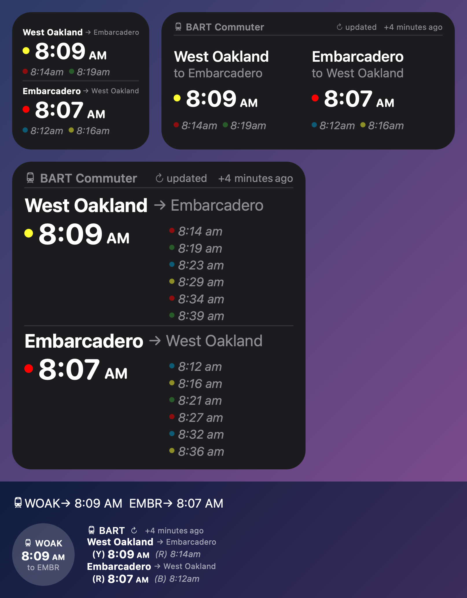
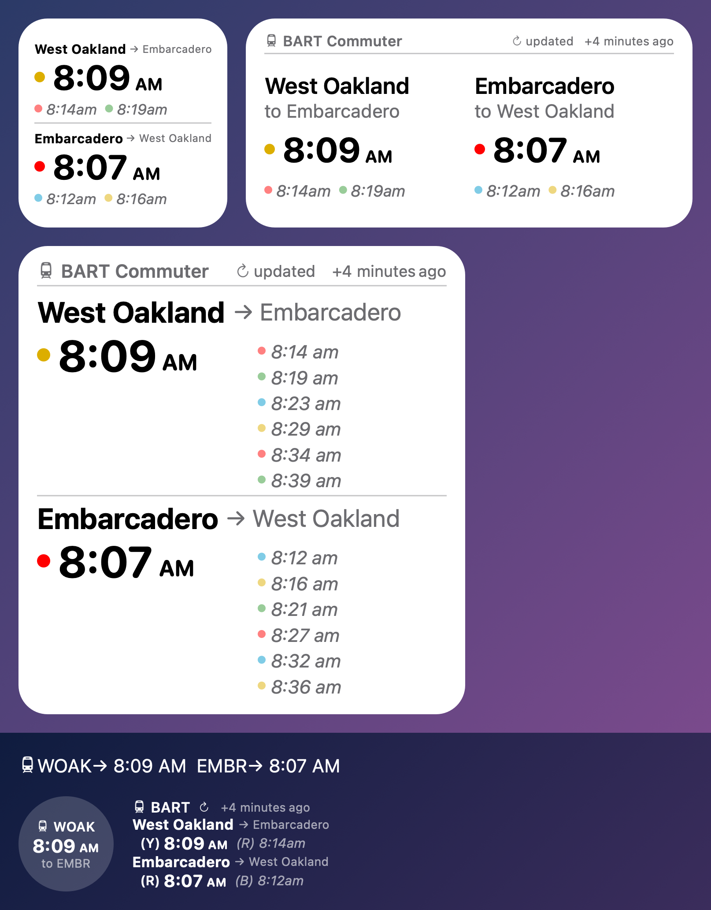

# BART Commuter

   [](https://codecov.io/github/elgeeko1/bart-commuter)

<p>
  
  
</p>

Your next BART trains on your iPhone home screen and lock screen, or from Siri. Enter your commute, such as West Oakland to Embarcadero, and see the fastest trips there and back with live departure times.

The widget runs in [Scriptable](https://apps.apple.com/us/app/scriptable/id1405459188), a free app for small scripts and widgets.

This is an independent project, not affiliated with or endorsed by the San Francisco Bay Area Rapid Transit District (BART).

## Features

- **Your commute, both ways.** See the next trains there and back in one widget, or every train leaving a single station.
- **Live departures.** Times come from BART's real-time data.
- **The fastest trips.** See direct trains and trips with one transfer, whichever gets you there soonest, with only the connections you can make.
- **Last train of the night.** Know when the next train is the last one.
- **Home Screen and Lock Screen.** Use any widget size, in light or dark.
- **Siri.** Ask for your next trains hands-free.
- **Private.** No account and no tracking.

## Install

Copy the widget's script into Scriptable, then add a Scriptable widget to your Home Screen or Lock Screen. This takes about five minutes.

1. Install [Scriptable](https://apps.apple.com/us/app/scriptable/id1405459188) from the App Store.
1. On your iPhone, open this page in Safari, scroll down to [The script](#the-script), and tap the copy button at the top right of the code box.
1. Open Scriptable and tap **+** at the top right to start a new script. Tap the empty editor, tap **Paste**, then tap **Done**.
1. Name the script: tap **Untitled Script** at the top of the editor and type **BART Commuter**.
1. Tap the script once to try it. The first run downloads the rest of the widget from this project's latest release, so connect to the internet first. Scriptable then shows a preview of the widget with live times.

Then add a widget, following Apple's [How to add and edit widgets on your iPhone](https://support.apple.com/en-us/118610):

- **Home Screen:** touch and hold an empty spot until the apps jiggle, tap **Edit**, then **Add Widget**, and search for Scriptable. Choose Small, Medium, or Large and tap **Add Widget**. Then touch and hold the new widget, tap **Edit Widget**, and set **Script** to BART Commuter.
- **Lock Screen:** touch and hold the Lock Screen, tap **Customize**, then **Lock Screen**, and tap the widget area below the clock. Choose Scriptable and the rectangular widget, then tap it and set **Script** to BART Commuter.

The widget starts with West Oakland to Embarcadero. To use your own stations, see [Pick your stations](#pick-your-stations).

## Pick your stations

Touch and hold the widget, tap **Edit Widget**, and type one or two [station codes](#station-codes) into **Parameter**. Each widget has its own Parameter, so different widgets can show different stations.

- **Two stations** are your commute. Type your starting station first. The widget shows the outbound trip, from there to the second station, then the return trip.
- **One station** shows every train leaving that station, in either direction.

| What you want | Parameter |
| -- | -- |
| West Oakland to Embarcadero, and back | leave empty, or `woak embr` |
| Rockridge to Powell St, and back | `rock powl` |
| Walnut Creek to Montgomery St, and back | `wcrk mont` |
| Every train leaving Embarcadero | `embr` |

### Station codes

| Code | Station | Code | Station |
| -- | -- | -- | -- |
| `12TH` | 12th St Oakland | `MCAR` | MacArthur |
| `16TH` | 16th St Mission | `MLBR` | Millbrae |
| `19TH` | 19th St Oakland | `MLPT` | Milpitas |
| `24TH` | 24th St Mission | `MONT` | Montgomery St |
| `ANTC` | Antioch | `NBRK` | North Berkeley |
| `ASHB` | Ashby | `NCON` | North Concord |
| `BALB` | Balboa Park | `OAKL` | Oakland Airport |
| `BAYF` | Bay Fair | `ORIN` | Orinda |
| `BERY` | Berryessa | `PCTR` | Pittsburg Center |
| `CAST` | Castro Valley | `PHIL` | Pleasant Hill |
| `CIVC` | Civic Center | `PITT` | Pittsburg/Bay Point |
| `COLM` | Colma | `PLZA` | El Cerrito Plaza |
| `COLS` | Coliseum | `POWL` | Powell St |
| `CONC` | Concord | `RICH` | Richmond |
| `DALY` | Daly City | `ROCK` | Rockridge |
| `DBRK` | Downtown Berkeley | `SANL` | San Leandro |
| `DELN` | El Cerrito del Norte | `SBRN` | San Bruno |
| `DUBL` | Dublin/Pleasanton | `SFIA` | SFO |
| `EMBR` | Embarcadero | `SHAY` | South Hayward |
| `FRMT` | Fremont | `SSAN` | South San Francisco |
| `FTVL` | Fruitvale | `UCTY` | Union City |
| `GLEN` | Glen Park | `WARM` | Warm Springs |
| `HAYW` | Hayward | `WCRK` | Walnut Creek |
| `LAFY` | Lafayette | `WDUB` | West Dublin |
| `LAKE` | Lake Merritt | `WOAK` | West Oakland |

## Ask Siri

1. Open the Shortcuts app and create a new shortcut.
1. Add Scriptable's Run Script action, choose BART Commuter, and turn off Run In App.
1. Optionally, type one or two station codes into the action's input, the same way as the widget Parameter.
1. Name the shortcut something easy to say, such as "Next BART".

Then say "Hey Siri, next BART" and Siri answers with something like "West Oakland to Embarcadero in 6 minutes, next 15 and 24. Embarcadero to West Oakland in 1 minute, next 12 and 21." When the next trip needs a transfer, Siri names it: "Rockridge to Fremont in 6 minutes, transfer at MacArthur, next 26 and 46."

## Good to know

- **iOS decides when widgets refresh**, often every 15 minutes or more, so times can lag. To see live times, touch and hold the widget, tap **Edit Widget**, and set **When Interacting** to **Run Script**; a tap then opens Scriptable with a fresh preview.
- **When BART's data is unavailable**, the widget says so rather than guess. This usually clears on the next refresh.
- **If the widget reports a problem with your stations**, check the station codes in Parameter.

## The script

Copy all of it, as described in [Install](#install).

<!-- BEGIN SCRIPT: generated by tools/readme_script.py; do not edit -->

```js
// Variables used by Scriptable.
// These must be at the very top of the file. Do not edit.
// icon-color: yellow; icon-glyph: subway;

// SPDX-FileCopyrightText: 2026 Jeff C. Jensen
// SPDX-License-Identifier: BSD-3-Clause
// https://github.com/elgeeko1/bart-commuter

const RELEASES_URL = "https://github.com/elgeeko1/bart-commuter/releases";
const MANIFEST_ASSET = "manifest.json";
const ENGINE_ASSET = "bart-commuter.js";
const ENGINE_API = 1;
const CHECK_INTERVAL_MS = 6 * 60 * 60 * 1000;

const INSTALL_DEADLINE_MS = 10 * 1000;
const CHECK_DEADLINE_MS = 20 * 1000;
const PARTIAL_MAX_AGE_MS = 60 * 1000;
const INSTALLING_TEXT = "Installing BART";
const VERSION_PATTERN = /^\d+\.\d+\.\d+$/;
const SHA256_PATTERN = /^[0-9a-f]{64}$/;

const STARTED = Date.now();
const TIMED_OUT = Symbol("timed out");
const files = FileManager.local();
const DIR = files.joinPath(files.documentsDirectory(), "bart-commuter");
const STATE_PATH = files.joinPath(DIR, "state.json");

const SHA256_K = [
  0x428a2f98, 0x71374491, 0xb5c0fbcf, 0xe9b5dba5, 0x3956c25b, 0x59f111f1, 0x923f82a4, 0xab1c5ed5, 0xd807aa98,
  0x12835b01, 0x243185be, 0x550c7dc3, 0x72be5d74, 0x80deb1fe, 0x9bdc06a7, 0xc19bf174, 0xe49b69c1, 0xefbe4786,
  0x0fc19dc6, 0x240ca1cc, 0x2de92c6f, 0x4a7484aa, 0x5cb0a9dc, 0x76f988da, 0x983e5152, 0xa831c66d, 0xb00327c8,
  0xbf597fc7, 0xc6e00bf3, 0xd5a79147, 0x06ca6351, 0x14292967, 0x27b70a85, 0x2e1b2138, 0x4d2c6dfc, 0x53380d13,
  0x650a7354, 0x766a0abb, 0x81c2c92e, 0x92722c85, 0xa2bfe8a1, 0xa81a664b, 0xc24b8b70, 0xc76c51a3, 0xd192e819,
  0xd6990624, 0xf40e3585, 0x106aa070, 0x19a4c116, 0x1e376c08, 0x2748774c, 0x34b0bcb5, 0x391c0cb3, 0x4ed8aa4a,
  0x5b9cca4f, 0x682e6ff3, 0x748f82ee, 0x78a5636f, 0x84c87814, 0x8cc70208, 0x90befffa, 0xa4506ceb, 0xbef9a3f7,
  0xc67178f2,
];

function sha256Hex(bytes) {
  const n = bytes.length;
  const padded = new Uint8Array(Math.ceil((n + 9) / 64) * 64);
  padded.set(bytes);
  padded[n] = 0x80;
  const view = new DataView(padded.buffer);
  view.setUint32(padded.length - 8, Math.floor(n / 0x20000000));
  view.setUint32(padded.length - 4, (n * 8) >>> 0);
  const h = Uint32Array.of(
    0x6a09e667,
    0xbb67ae85,
    0x3c6ef372,
    0xa54ff53a,
    0x510e527f,
    0x9b05688c,
    0x1f83d9ab,
    0x5be0cd19,
  );
  const w = new Uint32Array(64);
  const rotr = (x, r) => (x >>> r) | (x << (32 - r));
  for (let off = 0; off < padded.length; off += 64) {
    for (let i = 0; i < 16; i++) w[i] = view.getUint32(off + i * 4);
    for (let i = 16; i < 64; i++) {
      const s0 = rotr(w[i - 15], 7) ^ rotr(w[i - 15], 18) ^ (w[i - 15] >>> 3);
      const s1 = rotr(w[i - 2], 17) ^ rotr(w[i - 2], 19) ^ (w[i - 2] >>> 10);
      w[i] = w[i - 16] + s0 + w[i - 7] + s1;
    }
    let [a, b, c, d, e, f, g, k] = h;
    for (let i = 0; i < 64; i++) {
      const t1 = (k + (rotr(e, 6) ^ rotr(e, 11) ^ rotr(e, 25)) + ((e & f) ^ (~e & g)) + SHA256_K[i] + w[i]) >>> 0;
      const t2 = ((rotr(a, 2) ^ rotr(a, 13) ^ rotr(a, 22)) + ((a & b) ^ (a & c) ^ (b & c))) >>> 0;
      [k, g, f, e, d, c, b, a] = [g, f, e, (d + t1) >>> 0, c, b, a, (t1 + t2) >>> 0];
    }
    [a, b, c, d, e, f, g, k].forEach((x, i) => (h[i] += x));
  }
  return Array.from(h, (x) => x.toString(16).padStart(8, "0")).join("");
}

function compareVersions(a, b) {
  const [x, y] = [a, b].map((v) => v.split(".").map(Number));
  return x[0] - y[0] || x[1] - y[1] || x[2] - y[2];
}

function readState() {
  if (files.fileExists(STATE_PATH)) {
    try {
      const s = JSON.parse(files.readString(STATE_PATH));
      if ((s.version === null || VERSION_PATTERN.test(s.version)) && Number.isFinite(s.checked)) return s;
    } catch {}
    console.warn("unreadable loader state");
  }
  return { version: null, checked: 0 };
}

function writeState(state) {
  if (!files.fileExists(DIR)) files.createDirectory(DIR, true);
  files.writeString(STATE_PATH, JSON.stringify(state));
}

const enginePath = (version) => files.joinPath(DIR, `engine-${version}.js`);

async function download(url) {
  const req = new Request(url);
  const data = await req.load();
  if (req.response.statusCode !== 200) throw new Error(`HTTP ${req.response.statusCode} for ${url}`);
  return data;
}

async function latestRelease() {
  const m = JSON.parse((await download(`${RELEASES_URL}/latest/download/${MANIFEST_ASSET}`)).toRawString());
  if (!VERSION_PATTERN.test(m?.version) || !Number.isInteger(m.api) || !SHA256_PATTERN.test(m.sha256)) {
    throw new Error("invalid release manifest");
  }
  return m;
}

function evaluateEngine(source, version) {
  const module = { exports: {} };
  new Function("module", "exports", source)(module, module.exports);
  const engine = module.exports;
  if (engine.api !== ENGINE_API || typeof engine.run !== "function") throw new Error(`engine ${version} is malformed`);
  return engine;
}

function loadEngine(version) {
  const path = enginePath(version);
  if (!files.fileExists(path)) throw new Error(`engine ${version} is missing`);
  return evaluateEngine(files.readString(path), version);
}

async function installEngine({ version, sha256 }) {
  const data = await download(`${RELEASES_URL}/download/v${version}/${ENGINE_ASSET}`);
  if (sha256Hex(data.getBytes()) !== sha256) throw new Error(`engine ${version} does not match its checksum`);
  evaluateEngine(data.toRawString(), version);
  const path = enginePath(version);
  const partial = `${path}.${Date.now()}-${Math.random().toString(36).slice(2)}`;
  files.write(partial, data);
  if (files.fileExists(path)) files.remove(path);
  try {
    files.move(partial, path);
  } catch (e) {
    if (!files.fileExists(path)) throw e;
    files.remove(partial);
  }
}

function isPartialInProgress(name) {
  const m = /^engine-\d+\.\d+\.\d+\.js\.(\d+)-[a-z0-9]*$/.exec(name);
  const age = m ? Date.now() - Number(m[1]) : NaN;
  return age >= 0 && age < PARTIAL_MAX_AGE_MS;
}

function removeStaleFiles(version) {
  const keep = [STATE_PATH, enginePath(version)];
  for (const name of files.listContents(DIR)) {
    const path = files.joinPath(DIR, name);
    if (!keep.includes(path) && !isPartialInProgress(name)) files.remove(path);
  }
}

async function checkRelease(state) {
  const claimed = { ...state, checked: Date.now() };
  writeState(claimed);
  const manifest = await latestRelease();
  if (manifest.api !== ENGINE_API) {
    throw new Error(`release ${manifest.version} has engine interface ${manifest.api}, not ${ENGINE_API}`);
  }
  if (state.version && compareVersions(manifest.version, state.version) <= 0) return claimed;
  await installEngine(manifest);
  const next = { ...claimed, version: manifest.version };
  writeState(next);
  removeStaleFiles(next.version);
  return next;
}

function untilDeadline(promise, ms) {
  let timer = null;
  const expired = new Promise((resolve) => {
    timer = Timer.schedule(Math.max(0, STARTED + ms - Date.now()), false, () => resolve(TIMED_OUT));
  });
  return Promise.race([promise, expired]).finally(() => timer.invalidate());
}

function textWidget(text) {
  const widget = new ListWidget();
  widget.refreshAfterDate = new Date(Date.now() + 60 * 1000);
  widget.addText(text);
  return widget;
}

function loadInstalledEngine(version) {
  if (!version) return null;
  try {
    return loadEngine(version);
  } catch (e) {
    console.warn(e.message);
    return null;
  }
}

async function main() {
  const state = readState();
  const engine = loadInstalledEngine(state.version);
  if (!engine) {
    const installed = await untilDeadline(checkRelease({ ...state, version: null }), INSTALL_DEADLINE_MS);
    if (installed === TIMED_OUT) {
      if (!config.runsInWidget) throw new Error("engine install timed out");
      Script.setWidget(textWidget(INSTALLING_TEXT));
      return;
    }
    await loadEngine(installed.version).run();
    return;
  }
  const sinceCheck = Date.now() - state.checked;
  if (!config.runsInApp && sinceCheck >= 0 && sinceCheck < CHECK_INTERVAL_MS) {
    await engine.run();
    return;
  }
  const checking = checkRelease(state).catch((e) => console.warn(`release check: ${e.message}`));
  try {
    await engine.run();
  } finally {
    const checked = await untilDeadline(checking, CHECK_DEADLINE_MS);
    if (checked === TIMED_OUT) console.warn("release check: timed out");
  }
}

try {
  await main();
} catch (e) {
  if (!config.runsInWidget) throw e;
  Script.setWidget(textWidget(e.message));
} finally {
  Script.complete();
}
```

<!-- END SCRIPT -->

## License

[BSD 3-Clause](LICENSE). Contributions are welcome: see [CONTRIBUTING.md](CONTRIBUTING.md).

The BSD license does not cover BART's data. The generated `NETWORK` block in `bart-commuter.js` and the BART responses in `tests/fixtures` remain BART's and are used under its [Developer License Agreement](https://www.bart.gov/schedules/developers/developer-license-agreement).
